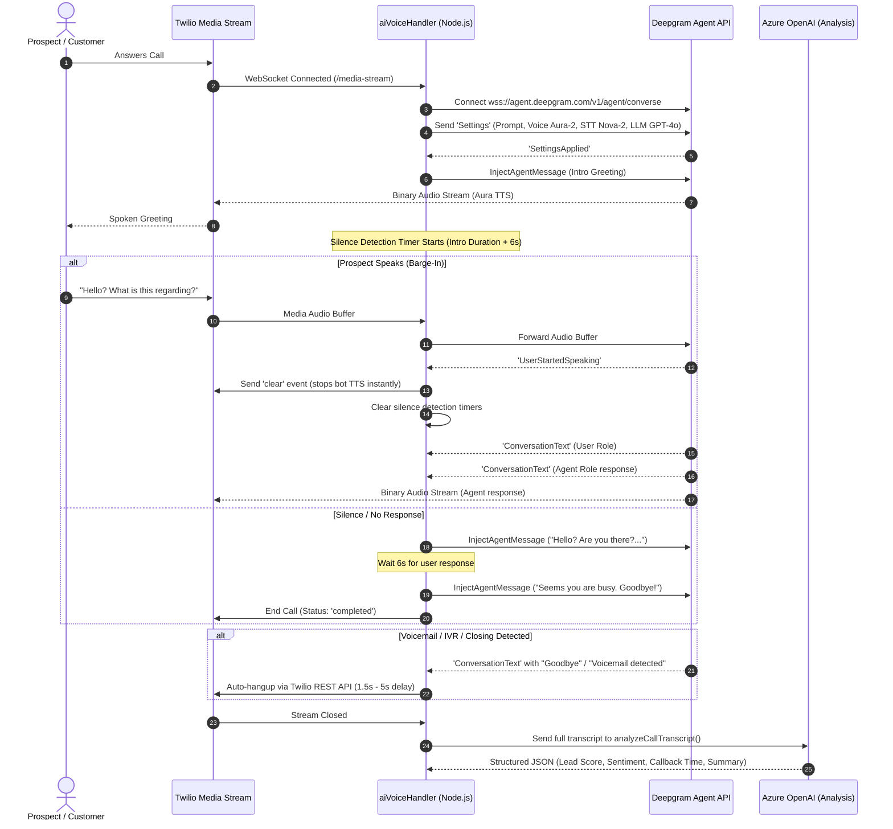

# AI Voice Agent Behavior Reference

This folder contains the reference implementation and behavioral codebase extracted from the original Deepgram + Twilio AI Voice Agent project.

Use this package specifically to understand, replicate, and study the **AI Voice Agent's calling behavior, conversation dynamics, system prompts, turn-taking, objection handling, voicemail detection, and call lifecycle management**.

---

## 📁 Extracted Files & Purpose

| File Path | Description & Behavioral Importance |
| :--- | :--- |
| [`backend/src/services/aiVoiceHandler.js`](file:///d:/Twilio-Web-Dialer/voice-agent-behavior-reference/backend/src/services/aiVoiceHandler.js) | **Core Agent Engine**: Manages the bi-directional Twilio Media Stream WebSocket and Deepgram Voice Agent WebSocket (`wss://agent.deepgram.com/v1/agent/converse`). Controls speech injection, silence detection, barge-in/interruption handling (`UserStartedSpeaking` -> Twilio `clear`), call duration limit enforcement, auto-hangup on goodbye/voicemail detection, audio accumulation, and post-call analysis triggering. |
| [`backend/src/repositories/aiSettingsRepository.js`](file:///d:/Twilio-Web-Dialer/voice-agent-behavior-reference/backend/src/repositories/aiSettingsRepository.js) | **Prompt & Behavior Configuration Defaults**: Defines default agent identity ("Aria"), 4-step conversation scripts, company elevator pitches, qualification questions, objection handling guidelines, machine/IVR detection instructions, and default wrap-up messages. |
| [`backend/src/services/openaiService.js`](file:///d:/Twilio-Web-Dialer/voice-agent-behavior-reference/backend/src/services/openaiService.js) | **Post-Call Analysis & RAG**: Handles post-call transcript evaluation (lead scoring 0-100, intent detection, sentiment analysis, strict interest level classification, callback time parsing, and summary extraction). Also provides vector similarity RAG search functions. |
| [`backend/src/routes/aiCalls.js`](file:///d:/Twilio-Web-Dialer/voice-agent-behavior-reference/backend/src/routes/aiCalls.js) | **Twilio Call Lifecycle & Webhooks**: Provides the outbound call triggering endpoint (`/api/ai/calls/start`), TwiML stream generation endpoint (`/voice/twiml`), Twilio call status callbacks (`/voice/status`), real-time active call termination, and settings/knowledge base API endpoints. |
| [`backend/src/services/campaignRunner.js`](file:///d:/Twilio-Web-Dialer/voice-agent-behavior-reference/backend/src/services/campaignRunner.js) | **Outbound Campaign Orchestrator**: Manages automated batch dialing, concurrency limits, contact state progression (`Pending` -> `Dialing` -> `Talking` -> `Completed`/`Ended Instantly`), and timeout guardrails. |

---

## 🧠 AI Agent Personality & Prompt Architecture

The system prompt dynamically structured in [`aiVoiceHandler.js`](file:///d:/Twilio-Web-Dialer/voice-agent-behavior-reference/backend/src/services/aiVoiceHandler.js#L356-L436) establishes strict behavioral constraints:

1. **Persona & Tone**:
   - Persona: *Aria*, calling on behalf of Vijay's team at DesireInfoWeb.
   - Tone: Friendly, Professional, Confident, Calm, Patient, Respectful, Helpful, Consultative.
   - AI Identity Disclosure: Warm, candid acknowledgment if asked if she is an AI, immediately steering back to the conversation.
2. **Conciseness (Critical Rule)**:
   - Max 15–20 words per response to maintain human-like dialogue and prevent monologue dumping.
   - Ask only **one question at a time**.
   - Speak in natural, plain text (never pronounce markdown symbols like `*` or `#`).
3. **Structured 4-Step Call Flow**:
   - **Step 1 (Greeting & Permission)**: Short 20-second intro stating purpose and asking if now is an okay time or if later suits better.
   - **Step 2 (Availability & Objections)**:
     - *If busy / later*: Ask politely for a better callback day/time, confirm, and hang up.
     - *If not interested*: Thank politely and end the call immediately.
     - *If free / asking details*: Advance to Step 3.
   - **Step 3 (Needs Discovery & Qualification)**: Ask qualification questions about their tech/automation/development needs.
   - **Step 4 (Call to Action / Consultation)**: Pitch a 10-minute specialist chat for next week.

---

## 🔄 Conversation Flow & Runtime Lifecycle

---

## ⚡ Key Behavioral Mechanisms

### 1. Barge-In & Interruption Handling
* When Deepgram detects speech (`UserStartedSpeaking`), [`aiVoiceHandler.js`](file:///d:/Twilio-Web-Dialer/voice-agent-behavior-reference/backend/src/services/aiVoiceHandler.js#L587-L602) sends a Twilio `clear` event on the media stream.
* Twilio flushes its audio playback buffer immediately, ensuring the agent stops speaking the millisecond the user interrupts.

### 2. Silence & Non-Response Recovery
* Dynamic silence detection timers calculate the duration of the initial greeting:
  $$\text{Timeout} = \left(\frac{\text{Word Count}}{2.0}\right) \times 1000\text{ ms} + 6000\text{ ms}$$
* If no user speech is detected:
  1. Injects a prompt: *"Hello? Are you there? Are you available?"*
  2. Waits 6 seconds. If still silent:
  3. Injects goodbye: *"It seems you might be busy. We will connect with you via email or call shortly. Goodbye!"* and disconnects.

### 3. Voicemail, IVR & Machine Detection (Credit Saving)
* The agent prompt instructs immediate short termination upon machine/IVR detection (*"Thank you for your time. Goodbye!"*).
* The server regex watches agent responses for voicemail markers and disconnects the call within 1500ms to avoid burning telephony/LLM credits.

### 4. Dynamic Call Duration Limit
* 180 seconds maximum if user spoke; 60 seconds maximum if no user response.
* Injects wrap-up message and gracefully terminates call at the limit.

### 5. Automated Post-Call Intelligence
* Evaluates conversational substance. If machine/voicemail was detected or customer words $< 5$, the lead summary is cleared (`""`), score set to `0`, and interest level set to `Not Answered`.
* Extracts explicit callback appointments and date/time requests.

---

> **Guidance for New Voice Agent Implementations:**
> Study the conversation flow, prompt constraints (conciseness, single-question cadence, objection handling branches), barge-in timing, silence recovery, and automated wrap-up logic in this reference package when building your new voice agent.
